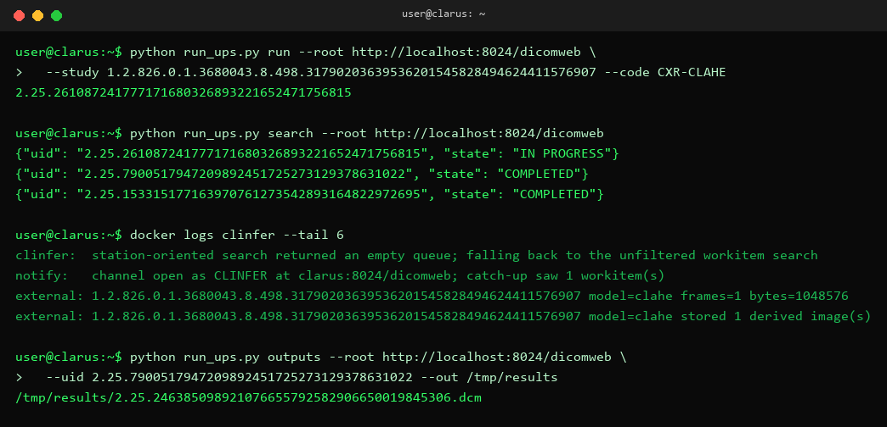

# SlicerUPS

CLI-first client for DICOMweb UPS-RS (PS3.18 section 11), for 3D Slicer and
for the command line. One standard task contract - search / run / cancel /
watch / download_outputs - against any conformant origin.

- **[Clarus](https://github.com/clicker71/clarus-pacs)**: full WebSocket channel
  (push, instant notification).
- **dcm4chee-arc**: no WebSocket server; the client transparently falls back
  to polling.

The user does not think about the transport; the result arrives when it is
ready.

## Screenshot



## Layering

- `slicer_ups_client/` - the core. Pure Python, **no Qt/Slicer imports**.
- `SlicerUPS.py` - the Slicer bridge: registers the module and imports results
  into the MRML scene (`import_outputs`).
- `hooks/` - examples for UI writers. Qt and shortcuts are allowed here.

The core only DOWNLOADS DICOM to a temp folder; it never touches the scene.

## CLI

Common flags:

- `--root` - DICOMweb root URL (e.g. `http://localhost:8024/dicomweb`).
- `--token` - optional Bearer token.
- `-v` / `--verbose` - debug logging.

### search - list workitems

```sh
python scripts/run_ups.py --root http://localhost:8024/dicomweb search --modality CT
```

Queries `GET /workitems` and prints each workitem's UID and state. Optional
`--modality` / `--body-part` filters. A `204 No Content` answer prints nothing
(an empty list, never an error).

### run - create a workitem and wait for it

```sh
python scripts/run_ups.py --root http://localhost:8024/dicomweb \
    run --study 1.2.3 --code 99CLARUS:CT-ORGAN-SEG --watch-mode auto
```

POSTs a workitem for the study, then watches it until COMPLETED or CANCELED
and prints the workitem UID. Flags:

- `--study` - Study Instance UID.
- `--code` - workitem code (`value` or `scheme:value`); optional when `--catalog` is given.
- `--modality` - default CT.
- `--body-part` - optional body part, used only for catalog matching.
- `--catalog` - alternative to `--code`: pick the code from a catalog file.
- `--watch-mode` - `auto` (default) | `websocket` | `poll`.
- `--poll-interval` - seconds between polls.
- `--timeout` - seconds before giving up.

The `99` prefix in a coding scheme designator is **not** a vendor extension.
PS3.3 section 8.2 defines designators beginning with `99` as private/local
coding schemes (per HL7 V2), so any `99...` scheme is equally valid -
`99CLARUS`, `99SLICER`, `99MYLAB`, and so on. Pick one that names your site or
product; the bare `--code value` shorthand defaults to the `99CLARUS` scheme.

### watch - wait for an existing workitem

```sh
python scripts/run_ups.py --root http://localhost:8024/dicomweb \
    watch --uid 1.2.3.4 --watch-mode auto
```

Blocks until the workitem reaches a terminal state and prints its final UID
and state. `--watch-mode auto` tries the WebSocket subscription and falls back
to polling; `websocket` / `poll` force one transport.

### cancel - cancel a workitem

```sh
python scripts/run_ups.py --root http://localhost:8024/dicomweb \
    cancel --uid 1.2.3.4 --reason "no longer needed"
```

Transitions the workitem to CANCELED (`PUT /workitems/{uid}/state`) carrying
Reason For Cancellation (0074,1238). `--reason` is optional.

### outputs - download the result instances

```sh
python scripts/run_ups.py --root http://localhost:8024/dicomweb \
    outputs --uid 1.2.3.4 --out /tmp/results
```

Reads Output Information Sequence (0040,4033) from the completed workitem and
downloads each referenced instance over WADO-RS into `--out` (defaults to a
temp dir), printing the file paths.

## Python

```python
from slicer_ups_client import UPSClient, DicomwebClient, Code

client = UPSClient(DicomwebClient("http://localhost:8024/dicomweb"))
uid = client.run("1.2.3", Code("CT-ORGAN-SEG", "99CLARUS"))
for path in client.download_outputs(uid):
    print(path)
```

## Task parameters

Workitem parameters travel through the Scheduled Processing Parameters
Sequence (0074,1210). Pass them to `run` / `create`:

```python
from slicer_ups_client import WorkitemParameter, Code

params = [
    WorkitemParameter(Code("99CLARUS:SENSITIVITY", "99CLARUS"), "NUMERIC", 0.7),
    WorkitemParameter(Code("99CLARUS:MODE", "99CLARUS"), "TEXT", "fast"),
]
```

## Per-node catalog

`--code` names one workitem code by hand. A site with several procedures
describes them once in a vendor-neutral catalog file and lets `--catalog`
pick the code for the study's modality:

```yaml
# catalog.yaml - the procedures this node offers (neutral, hand-written)
procedures:
  - match:
      modality: [CT]
      body_part: LUNG     # optional: narrow to one body part
    code:
      value: CT-ORGAN-SEG
      scheme: 99CLARUS    # any 99... private coding scheme
      meaning: Organ segmentation
  - match:
      modality: [CT]
    code:
      value: CT-BRAIN
      scheme: 99CLARUS
      meaning: Brain segmentation
  - match:
      modality: [DX, CR]
    code:
      value: CXR-AI
      scheme: 99CLARUS
      meaning: Chest X-ray AI
```

```sh
python scripts/run_ups.py --root http://localhost:8024/dicomweb \
    run --study 1.2.3 --catalog catalog.yaml --modality CT --body-part LUNG
```

`.yaml`/`.yml` need PyYAML; `.json` works with no extra dependency.
`match.body_part` narrows a procedure to one body part: with `--body-part`,
only entries whose `body_part` equals it (or that set none) are considered;
without `--body-part`, body-part-keyed entries never match. The code values
are the shared procedure vocabulary - `CXR-AI` for DX, `CT-ORGAN-SEG` for CT
- the same values clinfer dispatches on (see
[`clinfer.conf.example.en`](https://github.com/clicker71/clarus-pacs/blob/main/clinfer/clinfer.conf.example.en));
pair each with your own `99...` private scheme.

**This is not yet standardized.** A machine-readable capability description
is still being worked on: the IHE AI Service Properties (AISP) work item -
commonly called "AISCap" - is an active proposal, not a published profile.
Until it ships there is no standard catalog to consume, so each node carries
this per-node catalog instead.

## Python dependencies

`requests` is required: the default HTTP transport imports it when a
`DicomwebClient` is built without an injected session. The other two are
optional, loaded lazily, and never needed together:

- `requests` - required, the HTTP transport for every verb.
- `PyYAML` - optional, only for `.yaml`/`.yml` catalogs; `.json` catalogs
  work with no extra dependency. A missing PyYAML raises a clear RuntimeError
  suggesting a `.json` catalog instead.
- `websocket-client` - optional, only for WebSocket watch. With
  `--watch-mode auto` a missing package silently falls back to polling;
  `--watch-mode websocket` raises the underlying import error.

3D Slicer's embedded Python does **not** read `requirements.txt`
automatically. On the CLI use your own venv
(`pip install -r requirements.txt`); inside Slicer install the dependencies
per-node:

```python
slicer.packaging.pip_install("requests PyYAML websocket-client")
```

## License

MIT.
